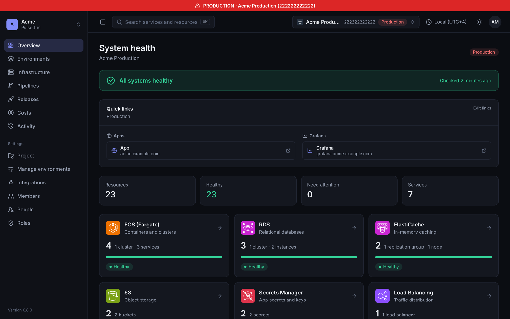
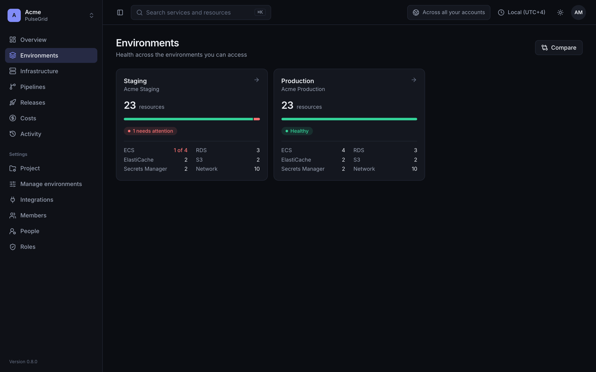
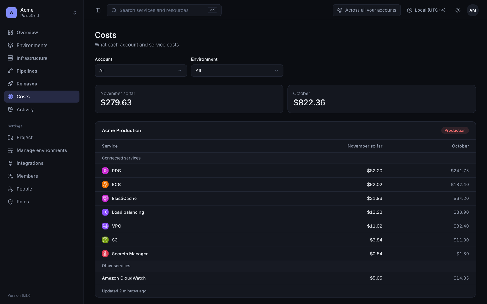
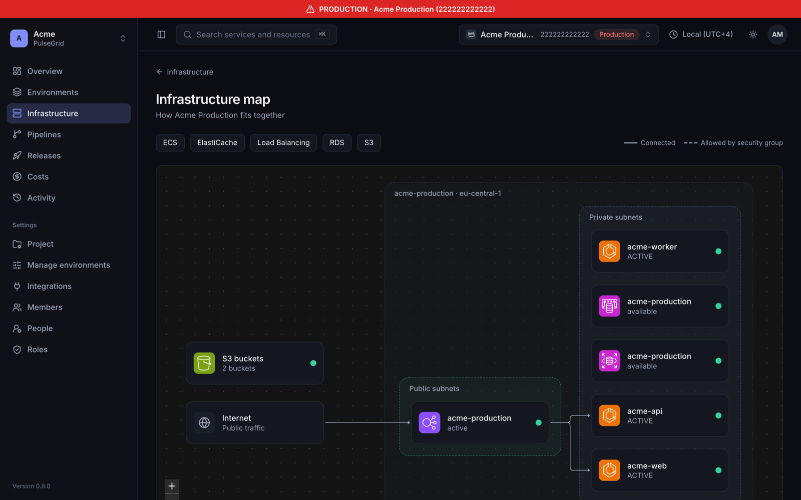

# PulseGrid

[](LICENSE)

PulseGrid is a self-hosted dashboard for your environments, pipelines and cloud infrastructure. You connect your AWS accounts and GitHub organizations once. After that, your team sees what's running, what's broken, what's deploying and what it costs, without everyone needing console access.

You run it in your own AWS account, so your keys and data stay with you.



## What you get

- **Health at a glance.** Overview shows problems, resource counts, work in progress, running pipelines and recent failures for each account, and refreshes itself.
- **Environments.** Group accounts into staging, production and anything else, compare them side by side, and keep each environment's app and Grafana links one click away.
- **Infrastructure map.** See how load balancers, services, databases and caches connect, including which security groups allow what.
- **Pipelines and releases.** Follow GitHub Actions runs per app and environment, and see when a change has rolled out to ECS and is ready for testing.
- **Costs.** Spending per account and service, this month so far and last month, from Cost Explorer.
- **Fault experiments.** Run AWS FIS experiment templates on staging and watch each step and the load on the resources they hit.
- **Activity.** Who did what, both in PulseGrid and in AWS (from CloudTrail Event history), plus ECS service logs on demand.
- **Projects and people.** Each project has its own accounts, integrations, environments and members. People are added once and assigned to the projects they need.
- **Safe by default.** Two-factor sign-in for everyone, custom roles, read-only access keys, and production that stays read-only. Actions that change cloud resources are off until you turn them on.

| Environments | Costs |
|---|---|
|  |  |



## What it works with

- **Cloud:** AWS, covering ECS, EC2, RDS and Aurora, ElastiCache and Valkey, S3, Secrets Manager, load balancers and VPCs.
- **Pipelines:** GitHub Actions.

Providers sit behind interfaces, so other clouds and Git hosts can be added. See [docs/cloud-providers.md](docs/cloud-providers.md) and [docs/git-providers.md](docs/git-providers.md).

## Install on AWS

PulseGrid runs as three small Fargate services: the web app, the API and a background worker, with Postgres and Valkey behind them. One Terraform run sets it up, either as a new stack or on a database, cache and load balancer you already have.

| | New stack | Existing resources |
|---|---|---|
| Creates | Network, load balancer, Postgres, Valkey and the services | The services, one secret and two load balancer rules |
| Costs, Frankfurt | About $120 a month | About $55 a month |

Follow [docs/install-aws.md](docs/install-aws.md). Then connect your first account with [docs/connect-aws-account.md](docs/connect-aws-account.md).

## Try it locally

You need Node 22, pnpm 9 and Docker.

```bash
cp .env.example .env
```

```bash
pnpm install
```

```bash
docker compose up -d --wait
```

```bash
pnpm db:migrate
```

```bash
pnpm dev
```

Open http://localhost:3000 and follow the setup wizard. The setup code is in the API log. See [docs/sign-in.md](docs/sign-in.md).

To look around without an AWS account, fill your new project with made-up demo data:

```bash
pnpm db:demo
```

Demo data only goes into a project with no cloud accounts yet. The made-up accounts have no access keys, so they never sync, and after a few minutes Overview notes that they haven't synced recently.

## Documentation

- [Install on AWS](docs/install-aws.md)
- [Connect an AWS account](docs/connect-aws-account.md)
- [Sign-in, projects, people and roles](docs/sign-in.md)
- [Environments](docs/environments.md)
- [Pipelines](docs/pipelines.md)

## Contributing and security

Contributions are welcome. [CONTRIBUTING.md](CONTRIBUTING.md) covers running the tests, how the code is laid out and the rules that keep projects apart. Please read the [code of conduct](CODE_OF_CONDUCT.md).

Report vulnerabilities privately as described in [SECURITY.md](SECURITY.md), not in public issues.

## License

Copyright 2026 Lavapi. Licensed under the [Apache License 2.0](LICENSE). See [NOTICE](NOTICE).

The AWS service icons and logo come from AWS Architecture Icons, and the GitHub logo from `@primer/octicons`. They're trademarks of their owners and are used only to show which service an integration connects to.
